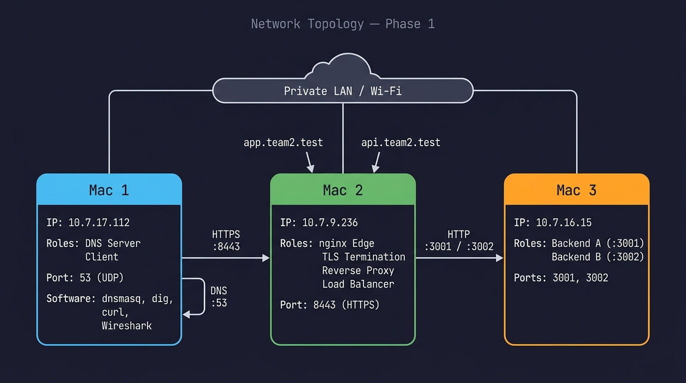
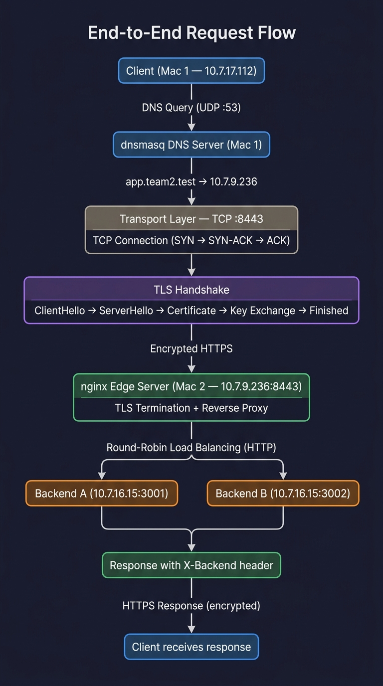
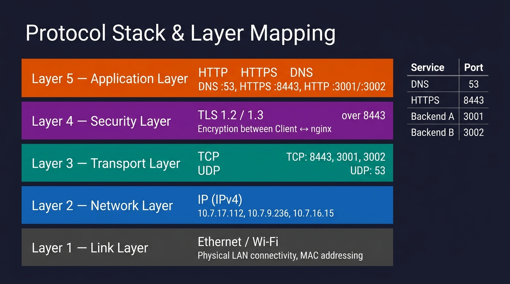

# Computer Networks — Phase 1

**Team 2 — Private Network Infrastructure**

A local Computer Networks project demonstrating DNS resolution, HTTPS/TLS termination, nginx reverse proxying, round-robin load balancing, HTTP caching, and Wireshark packet analysis. The entire system runs on three macOS machines connected via a private Wi-Fi LAN — no cloud infrastructure is used.

---

## Table of Contents

- [Architecture](#architecture)
- [Machine Setup](#machine-setup)
- [Network Topology](#network-topology)
- [End-to-End Request Flow](#end-to-end-request-flow)
- [Protocol Stack](#protocol-stack)
- [Software Used](#software-used)
- [DNS Configuration](#dns-configuration)
- [nginx Configuration](#nginx-configuration)
- [Load Balancing](#load-balancing)
- [TLS / HTTPS](#tls--https)
- [HTTP Caching](#http-caching)
- [Running the System](#running-the-system)
- [Testing the System](#testing-the-system)
- [Wireshark Verification](#wireshark-verification)
- [Failure Demonstrations](#failure-demonstrations)
- [Evidence](#evidence)
- [Project Limitations & Assumptions](#project-limitations--assumptions)
- [Repository Structure](#repository-structure)

---

## Architecture

```
Client (Mac 1) → Private DNS → nginx HTTPS Edge (Mac 2) → Backend A / Backend B (Mac 3)
```

The system follows a three-tier architecture:

1. **Mac 1** runs a private DNS server (dnsmasq) and acts as the test client.
2. **Mac 2** runs nginx as the HTTPS edge server, terminating TLS and load-balancing traffic across the backend pool.
3. **Mac 3** hosts two independent backend services (Backend A on port 3001, Backend B on port 3002).

All three machines are connected to the same private Wi-Fi LAN. The `.test` TLD is used for private DNS — it is an IETF-reserved domain (RFC 6761) that will never conflict with public DNS.

---

## Machine Setup

| Machine | IP Address    | Role                                  | Ports      |
| ------- | ------------- | ------------------------------------- | ---------- |
| Mac 1   | 10.7.17.112   | DNS Server (dnsmasq) + Test Client    | 53         |
| Mac 2   | 10.7.9.236    | nginx + TLS Termination + Load Balancer | 8443     |
| Mac 3   | 10.7.16.15    | Backend A + Backend B                 | 3001, 3002 |

> **Why three Macs?** Our team uses three physical machines instead of four. Backend A and Backend B are co-hosted on Mac 3 as separate processes running on different TCP ports. From a networking perspective, each backend is independently addressable and load-balanced by nginx.

### DNS Records

| Hostname         | Resolves To   | Purpose                   |
| ---------------- | ------------- | ------------------------- |
| `app.team2.test` | 10.7.9.236    | nginx HTTPS edge (Mac 2)  |
| `api.team2.test` | 10.7.9.236    | nginx HTTPS edge (Mac 2)  |

---

## Network Topology



```
                    Private LAN / Wi-Fi
          ┌──────────────┼──────────────┐
          │              │              │
      ┌───┴───┐     ┌───┴───┐     ┌───┴───┐
      │ Mac 1 │     │ Mac 2 │     │ Mac 3 │
      │       │     │       │     │       │
      │ DNS   │     │ nginx │     │ Bknd A│
      │Client │     │ TLS   │     │ :3001 │
      │       │     │ :8443 │     │       │
      │       │     │       │     │ Bknd B│
      │       │     │       │     │ :3002 │
      └───────┘     └───────┘     └───────┘
     10.7.17.112   10.7.9.236   10.7.16.15
```

---

## End-to-End Request Flow



When a client accesses `https://app.team2.test:8443/api/status`:

| Step | Action                                | Protocol     | Layer            |
| ---- | ------------------------------------- | ------------ | ---------------- |
| 1    | DNS query for `app.team2.test`        | DNS (UDP)    | Application      |
| 2    | DNS response: `10.7.9.236`            | DNS (UDP)    | Application      |
| 3    | TCP three-way handshake to `:8443`    | TCP          | Transport        |
| 4    | TLS handshake (ClientHello → Finished)| TLS 1.2/1.3  | Security/Session |
| 5    | HTTPS request (encrypted)             | HTTPS        | Application      |
| 6    | nginx TLS termination                 | —            | —                |
| 7    | nginx reverse proxy → backend pool    | HTTP         | Application      |
| 8    | Backend A or B responds               | HTTP         | Application      |
| 9    | nginx encrypts and returns response   | HTTPS        | Application      |

---

## Protocol Stack



| Layer              | Protocol        | Port(s)          | Purpose                          |
| ------------------ | --------------- | ---------------- | -------------------------------- |
| Application        | DNS             | 53 (UDP)         | Hostname resolution              |
| Application        | HTTP            | 3001, 3002       | Backend communication            |
| Application        | HTTPS           | 8443             | Client-to-nginx (encrypted)      |
| Security/Session   | TLS 1.2/1.3     | (over 8443)      | Encryption at nginx edge         |
| Transport          | TCP             | 8443, 3001, 3002 | Reliable delivery                |
| Transport          | UDP             | 53               | DNS (connectionless)             |
| Network            | IP (IPv4)       | —                | Addressing and routing           |
| Link               | Ethernet/Wi-Fi  | —                | Physical LAN connectivity        |

---

## Software Used

| Software   | Version   | Machine | Purpose                            |
| ---------- | --------- | ------- | ---------------------------------- |
| dnsmasq    | latest    | Mac 1   | Private DNS server                 |
| dig        | system    | Mac 1   | DNS query tool                     |
| curl       | system    | Mac 1   | HTTP/HTTPS client                  |
| Wireshark  | latest    | Mac 1   | Packet capture and analysis        |
| nginx      | latest    | Mac 2   | Reverse proxy, TLS, load balancer  |
| openssl    | system    | Mac 2   | TLS certificate generation         |
| Node.js    | LTS       | Mac 3   | Backend A and Backend B runtime    |

---

## DNS Configuration

Mac 1 runs dnsmasq as a private DNS server. The configuration maps:

```
address=/app.team2.test/10.7.9.236
address=/api.team2.test/10.7.9.236
```

When any machine on the LAN uses Mac 1 as its DNS server (10.7.17.112), it can resolve `app.team2.test` to Mac 2's IP address.

**Verification:**

```bash
dig @10.7.17.112 app.team2.test
# Expected: app.team2.test → 10.7.9.236
```

See [`config/dnsmasq/README.md`](config/dnsmasq/README.md) for full setup instructions.

---

## nginx Configuration

nginx on Mac 2 acts as the single entry point. It:

1. Listens on port **8443** for HTTPS connections.
2. **Terminates TLS** — decrypts incoming traffic.
3. **Reverse proxies** — forwards requests to the backend pool.
4. **Load balances** — distributes traffic using round-robin.

```nginx
upstream backend_pool {
    server 10.7.16.15:3001;   # Backend A
    server 10.7.16.15:3002;   # Backend B
}

server {
    listen       8443 ssl;
    server_name  app.team2.test;

    ssl_certificate      /usr/local/etc/nginx/ssl/app.team2.test.crt;
    ssl_certificate_key  /usr/local/etc/nginx/ssl/app.team2.test.key;

    location / {
        proxy_pass         http://backend_pool;
        proxy_set_header   Host              $host;
        proxy_set_header   X-Real-IP         $remote_addr;
        proxy_set_header   X-Forwarded-For   $proxy_add_x_forwarded_for;
        proxy_set_header   X-Forwarded-Proto $scheme;
        proxy_pass_header  X-Backend;
    }
}
```

See [`config/nginx/README.md`](config/nginx/README.md) for deployment instructions.

---

## Load Balancing

nginx distributes requests across Backend A and Backend B using **round-robin** (the default algorithm). Each backend sets an `X-Backend` response header (`A` or `B`), which nginx passes through to the client.

**Verification:**

```bash
for i in $(seq 1 6); do
  curl -s -D - https://app.team2.test:8443/api/status -o /dev/null | grep X-Backend
done
```

Expected output shows alternation:

```
X-Backend: A
X-Backend: B
X-Backend: A
X-Backend: B
X-Backend: A
X-Backend: B
```

---

## TLS / HTTPS

HTTPS is configured at the nginx edge (Mac 2, port 8443). TLS terminates at nginx — traffic between nginx and backends is plain HTTP over the private LAN.

### TLS Handshake

```
Client                               nginx (Mac 2)
  │── ClientHello ──────────────────▶│
  │◀── ServerHello ─────────────────│
  │◀── Certificate ─────────────────│  (app.team2.test)
  │◀── ServerKeyExchange ───────────│
  │── ClientKeyExchange ───────────▶│
  │── ChangeCipherSpec / Finished ─▶│
  │◀── ChangeCipherSpec / Finished ─│
  │◀═══ Encrypted Application Data ═▶│
```

### Certificate Setup

A private Certificate Authority (CA) is used. The CA certificate is trusted on the client machine so that `curl` (without `--insecure`) and browsers validate the certificate correctly.

> **Important:** The final demonstration does NOT use `curl -k` / `--insecure`. Proper certificate validation is required.

See [`config/tls/README.md`](config/tls/README.md) for certificate generation instructions.

---

## HTTP Caching

Both backends support HTTP caching on the `/api/status` endpoint:

| Header          | Value                   | Purpose                              |
| --------------- | ----------------------- | ------------------------------------ |
| `Cache-Control` | `public, max-age=30`    | Response can be cached for 30 seconds |
| `ETag`          | `"<md5-hash>"`          | Content-based cache validation token  |

### Caching Flow

```
1. Fresh request:
   GET /api/status → 200 OK + Cache-Control + ETag + body

2. Conditional request:
   GET /api/status + If-None-Match: "<etag>" → 304 Not Modified (no body)

3. Stale request:
   GET /api/status + If-None-Match: "<old-etag>" → 200 OK + new ETag + body
```

**Verification:**

```bash
# Step 1: Get the ETag
curl -v https://app.team2.test:8443/api/status
# Note the ETag value from the response headers

# Step 2: Send conditional request
curl -v -H 'If-None-Match: "<etag-value>"' https://app.team2.test:8443/api/status
# Should return 304 Not Modified
```

---

## Running the System

### 1. Start DNS (Mac 1)

```bash
sudo brew services start dnsmasq
```

### 2. Start Backends (Mac 3)

Open two terminal windows:

```bash
# Terminal 1 — Backend A
cd backend/backend-a
node server.js
# Output: Backend A listening on 0.0.0.0:3001
```

```bash
# Terminal 2 — Backend B
cd backend/backend-b
node server.js
# Output: Backend B listening on 0.0.0.0:3002
```

Or use the provided scripts:

```bash
./scripts/start-backend-a.sh
./scripts/start-backend-b.sh
```

### 3. Start nginx (Mac 2)

```bash
# Copy configuration
cp config/nginx/nginx.conf /usr/local/etc/nginx/servers/app.team2.test.conf

# Test configuration
nginx -t

# Start
brew services start nginx
```

Ensure TLS certificates are in place first (see [`config/tls/README.md`](config/tls/README.md)).

---

## Testing the System

### DNS

```bash
./scripts/test-dns.sh
# or manually:
dig @10.7.17.112 app.team2.test
```

### HTTPS

```bash
./scripts/test-https.sh
# or manually:
curl -v https://app.team2.test:8443/api/status
```

### Load Balancing

```bash
./scripts/test-load-balancing.sh
```

See [`docs/phase1-demo-script.md`](docs/phase1-demo-script.md) for the full demonstration sequence.

---

## Wireshark Verification

Wireshark captures on Mac 1 verify the system at the packet level.

### DNS (UDP port 53)

- Filter: `dns`
- Shows: DNS query for `app.team2.test` → response `10.7.9.236`

### TCP Three-Way Handshake

- Filter: `ip.addr == 10.7.9.236 && tcp.port == 8443`
- Shows: SYN → SYN-ACK → ACK to port 8443

### TLS Handshake

- Filter: `tls && ip.addr == 10.7.9.236`
- Shows: ClientHello → ServerHello → Certificate → encrypted Application Data

### Backend Traffic

- Captured on Mac 2 or Mac 3
- Filter: `tcp.port == 3001 || tcp.port == 3002`
- Shows: Plain HTTP between nginx and backends (TLS terminated at nginx)

> **Note:** HTTP content between client and nginx is **encrypted** because TLS terminates at nginx. Only the TLS handshake metadata is visible in Wireshark; the actual HTTP requests/responses appear as "Application Data."

---

## Failure Demonstrations

Controlled failure scenarios demonstrate system resilience:

| # | Scenario                 | Expected Behavior                                    |
|---|--------------------------|------------------------------------------------------|
| 1 | Backend A goes down      | All traffic routes to Backend B                      |
| 2 | Backend B goes down      | All traffic routes to Backend A                      |
| 3 | Both backends go down    | nginx returns `502 Bad Gateway`                      |
| 4 | DNS server goes down     | Hostname resolution fails; direct IP access still works |

See [`evidence/10-failure-demonstrations/README.md`](evidence/10-failure-demonstrations/README.md) for detailed instructions.

---

## Evidence

All evidence is organized in the [`evidence/`](evidence/) directory. Each subfolder contains a `README.md` explaining exactly what screenshots to capture and place there.

| Folder                          | Evidence Type                              |
| ------------------------------- | ------------------------------------------ |
| `01-lan-connectivity/`          | Ping tests between all three Macs          |
| `02-dns/`                       | `dig` output showing DNS resolution        |
| `03-backends/`                  | Direct `curl` to Backend A and B           |
| `04-nginx-load-balancing/`      | X-Backend header alternation               |
| `05-tls/`                       | HTTPS with certificate validation          |
| `06-wireshark-dns/`             | Wireshark DNS packet capture               |
| `07-wireshark-tcp/`             | Wireshark TCP handshake capture            |
| `08-wireshark-tls/`             | Wireshark TLS handshake capture            |
| `09-http-caching/`              | Cache-Control, ETag, 304 responses         |
| `10-failure-demonstrations/`    | Controlled failure and recovery scenarios  |

See [`evidence/README.md`](evidence/README.md) for the complete checklist.

---

## Project Limitations & Assumptions

1. **Three Macs instead of four:** Backend A and Backend B are co-hosted on Mac 3. They are separate processes on different ports, functionally equivalent to separate machines.
2. **Port 8443 instead of 443:** Used to avoid requiring root privileges for nginx on macOS.
3. **Private CA:** Since `.test` is not a publicly registered domain, we use a self-signed CA. The CA certificate is manually trusted on client machines.
4. **DHCP IP addresses:** If the Macs obtain new IP addresses via DHCP, all configurations (dnsmasq, nginx upstream, documentation) must be updated accordingly.
5. **No persistent data:** The backends are stateless — they do not use a database or store data. This is intentional; the project evaluates networking, not application complexity.
6. **Backend-to-nginx traffic is unencrypted:** TLS terminates at nginx. Traffic between nginx and backends is plain HTTP, which is acceptable on a trusted private LAN.

---

## Repository Structure

```
cn-phase-1/
│
├── README.md                          ← this file
├── .gitignore
│
├── docs/
│   ├── architecture.md                ← detailed architecture document
│   ├── network-topology.jpg           ← network topology diagram
│   ├── request-flow.jpg               ← end-to-end request flow diagram
│   ├── protocol-stack.jpg             ← protocol/layer mapping diagram
│   ├── phase1-demo-script.md          ← step-by-step demo instructions
│   ├── troubleshooting.md             ← common issues and solutions
│   └── viva-preparation.md            ← anticipated Q&A for oral exam
│
├── config/
│   ├── dnsmasq/
│   │   └── README.md                  ← dnsmasq setup instructions
│   ├── nginx/
│   │   ├── nginx.conf                 ← nginx configuration file
│   │   └── README.md                  ← nginx deployment guide
│   └── tls/
│       └── README.md                  ← TLS/certificate setup guide
│
├── backend/
│   ├── backend-a/
│   │   ├── server.js                  ← Backend A (port 3001)
│   │   ├── package.json
│   │   └── README.md
│   └── backend-b/
│       ├── server.js                  ← Backend B (port 3002)
│       ├── package.json
│       └── README.md
│
├── scripts/
│   ├── start-backend-a.sh             ← start Backend A
│   ├── start-backend-b.sh             ← start Backend B
│   ├── test-dns.sh                    ← test DNS resolution
│   ├── test-https.sh                  ← test HTTPS connectivity
│   └── test-load-balancing.sh         ← test round-robin balancing
│
└── evidence/
    ├── README.md                      ← evidence checklist
    ├── 01-lan-connectivity/README.md
    ├── 02-dns/README.md
    ├── 03-backends/README.md
    ├── 04-nginx-load-balancing/README.md
    ├── 05-tls/README.md
    ├── 06-wireshark-dns/README.md
    ├── 07-wireshark-tcp/README.md
    ├── 08-wireshark-tls/README.md
    ├── 09-http-caching/README.md
    └── 10-failure-demonstrations/README.md
```
